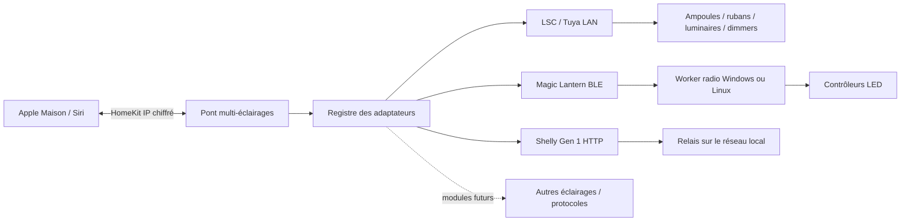

# Architecture du pont

Le projet devient Lantern Bridge : une passerelle locale Windows/Linux/Raspberry Pi, des adaptateurs de produits d’éclairage et des services HomeKit. La première intégration est Magic Lantern ; elle n’impose plus son protocole au cœur du pont. Il n’y a plus de client mobile à construire.

| Dossier | Responsabilité |
|---|---|
| `gateway/` | Configuration versionnée, registre, pont HAP multi-éclairages, CLI et adaptateurs |
| `homekit/` | Moteur de lampe, stockage/identité, services HAP, canal privé ; point d’entrée historique `server.js` préservé pour migration |
| `windows/` | Shell natif et module radio Windows ; `--adapter-worker` travaille sans fenêtre par stdio |
| `linux/` | Shell Python, BlueZ, service ; `adapter_worker.py` est le worker du nouveau pont |
| `ui/` | GUI partagé ; module Magic Lantern et présentation du nouveau pont |
| `docs/protocols/` | Protocoles matériels documentés et provenance des trames |
| `installer/`, `scripts/` | Installation et paquets reproductibles Windows/x64/ARM64 |

Le transport HomeKit ne dépend pas du modèle de produit. Les services implémentés sont les lampes (fonctions adaptées au profil) et les interrupteurs de relais d’éclairage. Les UUID sont dérivés des identifiants permanents, pas de l’ordre du fichier ni des noms affichés. Les clés HAP restent sur la passerelle. Un verrou de stockage exclut deux processus sur une même identité. Chaque radio/contrôleur possède aussi un verrou, partagé avec les clients existants.

Les drivers radio sont des processus enfants : stdin/stdout JSON privés, délais limités et annulation, fermeture à EOF. Le worker Windows réutilise `BleController`; le worker Linux réutilise `Controller`. Pas de service Bluetooth ouvert sur le réseau. Le pont peut redémarrer un worker absent avec un délai de reprise. Une radio hors ligne marque seulement son accessoire indisponible.

Le moteur de lampe regroupe les changements HomeKit et restaure la dernière consigne après reconnexion. ObservedEngine lit l’état physique (LSC/Shelly), regroupe les écritures et ne rejoue aucune consigne au démarrage. Les caractéristiques Maison sont construites à partir des fonctions du profil ; un blanc réglable n’annonce pas de RGB. LSC utilise des workers courts et limités à quatre simultanément, avec un verrou par endpoint TCP et arrêt avant retour d’erreur. Une future capacité doit définir explicitement sa politique de lecture et de reconnexion.

## Ajouter une intégration

1. Documenter les modèles/firmwares, le transport, l’authentification et les fonctions réellement disponibles.
2. Implémenter un adaptateur dans `gateway/adapters/`, sans dépendance au GUI et sans log de secrets. Les appareils à état lisible exposent `read()`, `apply(patch)`, `close()` et un descripteur de caractéristiques d’éclairage. Les lampes RGB exposent `status()`, `apply({on,brightness,hue,saturation})`, `close()`.
3. Ajouter une entrée explicite dans `gateway/registry.js` : identifiant stable, options autorisées, validation, identité de cible (détection des doublons), fabricant, capacité et factory.
4. Tester un échange de protocole, une erreur, une déconnexion et l’absence d’impact sur un autre appareil. Ajouter une nouvelle capacité HomeKit si nécessaire en restant dans le périmètre de l’éclairage.
5. Vérifier physiquement le produit et documenter la compatibilité. Un adaptateur passé en tests simulés ne constitue pas une validation de tous les modèles d’une marque.

La configuration n’exécute pas de scripts ou de modules arbitraires. Les futurs plugins devront avoir une installation et un contrat explicites. Les futurs modules restent consacrés à l’éclairage. Un autre transport (BLE, Zigbee, cloud) exige son intégration propre ; aucun support de capteurs, volets, thermostats ou caméras n’est prévu dans ce périmètre.
